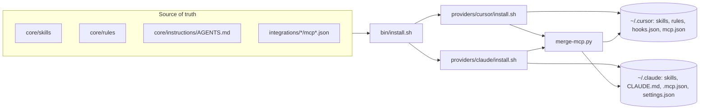

# Architecture

Orientation for agents (and humans) working **on** this repo. For installing it
on a machine, see [`SETUP.md`](SETUP.md).

## Mental model

This repo is the **single source of truth** for personal AI-agent configuration.
It is provider-agnostic: one set of skills, instructions, rules, and MCP
integrations is authored here, then **rendered** into provider-specific paths
(`~/.cursor/*`, `~/.claude/*`) by install scripts. Nothing under `$HOME` is
authored by hand — it is all generated or symlinked from here.

```
        author here (git)                 render (bin/install.sh)            consumed by
  ┌──────────────────────────┐       ┌───────────────────────────┐      ┌──────────────┐
  │ core/skills/   (SKILL.md) │       │ providers/cursor/install  │─────▶│ ~/.cursor/*  │
  │ core/rules/    (*.mdc)    │──────▶│ providers/claude/install  │─────▶│ ~/.claude/*  │
  │ core/instructions/AGENTS  │       │ providers/shared/merge-mcp│      └──────────────┘
  │ integrations/* (mcp*.json)│       └───────────────────────────┘
  │ catalog/plugins.yaml      │
  └──────────────────────────┘
```



## Directory map

| Path | Role |
|------|------|
| `core/skills/<name>/SKILL.md` | Personal skills. Symlinked to `~/.cursor/skills` and `~/.claude/skills`. |
| `core/rules/*.mdc` | Cursor rules (with `description` / `alwaysApply` frontmatter). Symlinked to `~/.cursor/rules`. |
| `core/instructions/AGENTS.md` | Portable agent instructions (the [agents.md](https://agents.md) convention). Inlined into the generated `~/.claude/CLAUDE.md`. |
| `core/instructions/user-rules/*.md` | Detailed rule docs, appended to `CLAUDE.md` and referenced from `AGENTS.md`. |
| `core/workflows/README.md` | Decision guide for when to reach for which skill/plugin. |
| `integrations/<name>/mcp*.json` | MCP server fragments, collected and merged into provider `mcp.json` files. |
| `integrations/<name>/README.md` | Per-integration setup notes (binaries, env). |
| `catalog/plugins.yaml` | Marketplace plugins — **catalogued, never vendored**. |
| `providers/<p>/install.sh` | Renders the source into provider paths. |
| `providers/shared/merge-mcp.py` | Builds provider `mcp.json` from fragments + overlay. |
| `providers/claude/CLAUDE.md.stub`, `settings.json.template` | Claude scaffolding. |
| `secrets/.env` | Machine-local values (gitignored). Only `.env.example` is tracked. |
| `evals/` | Behavioral eval harness — one case per global default + LLM-judge runner. |
| `bin/install.sh` | Entry point. `--provider cursor\|claude\|all`, `--dry-run`. |
| `bin/doctor.sh` | Health check. `--deep` validates generated JSON + binaries. |
| `bin/ci-check.sh` | Static checks (shell, JSON, YAML, frontmatter, evals). |

## How install works

`bin/install.sh` resolves `AGENTIC_ROOT` dynamically (so it runs from any clone
location), sources `secrets/.env`, and dispatches to provider installers.

- **Cursor** (`providers/cursor/install.sh`): `link_skills` → `install_mcp` →
  `install_rules` → `install_hooks`.
- **Claude** (`providers/claude/install.sh`): `link_skills` → `install_claude_md`
  (stub + `AGENTS.md` + user-rules) → `install_mcp` → `install_settings_template`.

Both call `merge-mcp.py`. All destructive writes back up the previous file with a
timestamp suffix; `DRY_RUN=1` makes every step print-only.

## merge-mcp behavior (important invariants)

- Collects every `integrations/**/mcp*.json` fragment plus the Cursor overlay.
- **Merges into** the existing target `mcp.json` — repo-managed servers overwrite
  same-named entries, but servers added by hand (e.g. work-only `dora`,
  `grafana-*`) are **preserved**. Never blindly overwrite the target.
- Substitutes any `__KEY__` placeholder from the environment / `.env`
  (`__NPX__`, `__LEAN_CTX__`, `__LEAN_CTX_DATA_DIR__`, …); `~` in `.env` values
  is expanded.
- Fails with the offending file path on malformed JSON.

## Conventions / invariants

- **Catalog, don't vendor.** Third-party marketplace plugins go in
  `catalog/plugins.yaml` only — never copy their skill trees in.
- **Skills** are `core/skills/<name>/SKILL.md` with YAML frontmatter that has at
  least `name` and `description` (the description drives trigger matching).
  `bin/ci-check.sh` enforces this.
- **No secrets in the repo.** Real values live in `secrets/.env` (gitignored);
  fragments use `__PLACEHOLDER__` tokens. The repo is private, but still keep
  secrets out of tracked files.
- **The canonical path is `~/Documents/GitHub/personal/agentic-cfg`** — docs and
  the generated `CLAUDE.md` pointer assume it.
- **Tool precedence** (GitNexus vs lean-ctx `ctx_*` vs `rtk`) is defined once in
  `AGENTS.md`; don't restate conflicting rules elsewhere.

## How to extend

| Goal | Do this |
|------|---------|
| Add a skill | Create `core/skills/<name>/SKILL.md` with frontmatter. It auto-syncs via the symlink — no install code change. |
| Add a Cursor rule | Drop `core/rules/<name>.mdc`; `install_rules` links it. |
| Add an MCP server | Create `integrations/<name>/mcp.stdio.json` (use `__PLACEHOLDER__` for machine-specific values) + a short README. Add defaults to `merge-mcp.load_env` and `secrets/.env.example` if it needs new env. |
| Add an eval | Drop a JSON case in `evals/cases/` (see `evals/README.md`). |
| Change global behavior | Edit `core/instructions/AGENTS.md`; add an eval case that proves the behavior. |

After any change: `bin/ci-check.sh`, then `bin/install.sh --dry-run` to preview.

## Gotchas

- Re-running the full installer regenerates `mcp.json` — safe now (it merges),
  but always check the `--dry-run` if you changed `merge-mcp.py`.
- `rtk` and the `lean-ctx` binary are **referenced, not installed** by this repo.
- `.github/workflows/ci.yml` exists locally but is untracked until a gh token has
  the `workflow` scope.
- Pushing uses repo-local git identity (`Tsurai7`) and a credential-helper /
  `insteadOf` workaround — see the project memory if `git push` misbehaves.
