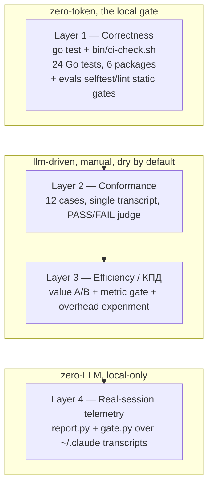

# Testing and efficiency measurement (КПД) in agentic-cfg

This document onboards a new agent (or human) to how `agentic-cfg` is tested and how
its efficiency — its "КПД" / KPI — is measured. Read the TL;DR, run the zero-token
quickstart, then dive into the layer that matches what you changed.

> This document describes the `master` line (`origin/master`), the canonical branch. A
> few facts below are branch-sensitive and are called out explicitly: the deterministic
> tool benchmarks and the measure-and-uplift ADR set live on other branches, not on
> `master`.

The repo is the source of truth for a personal agent configuration: skills, rules, MCP
wiring, an install/merge toolchain (a Go `agentic` CLI plus legacy Python reference
scripts), and an eval + telemetry harness that proves the configuration changes agent
behavior for the better. Testing here therefore spans two very different questions:

1. Does the machinery (install/merge/hook glue) behave correctly? — deterministic, zero-token.
2. Does the configuration make the agent behave better and cheaper? — partly LLM-driven, partly measured from real telemetry.

## 1. TL;DR — the four-layer model

Testing in this repo is organized as a pyramid of four layers. The wide, cheap base
runs on every change with zero model tokens; the narrow, expensive top spends real
tokens and is run by hand.

| Layer | What it answers | Primary command | What it guards | Token cost |
|-------|-----------------|-----------------|----------------|------------|
| 1. Correctness | Does the install/merge/hook machinery behave correctly? | `make check` (or `go test ./...`, `bash bin/ci-check.sh`) | Go CLI + Python parity, idempotent merges, shell-guard decisions, end-to-end install | zero-deterministic |
| 2. Behavioral conformance | Does a rule/skill actually trigger and change behavior (and stay quiet when it should)? | `AGENTIC_EVAL_CONFIRM=1 python3 evals/run.py --track conformance` | 12 single-transcript PASS/FAIL cases judged by an LLM | llm-driven |
| 3. Efficiency / КПД | Is the configuration measurably better or cheaper than without it? | `AGENTIC_EVAL_CONFIRM=1 python3 evals/run.py --track value` and `--track metric` | A/B treatment-vs-control, cache-hit-rate threshold, overhead experiment | llm-driven + real-session-telemetry |
| 4. Real-session telemetry | What is the production token economy on real day-to-day sessions? | `python3 telemetry/report.py`, `python3 telemetry/gate.py` | Token-weighted cache-hit-rate KPI over real `~/.claude` transcripts | real-session-telemetry (zero-LLM) |

Token-cost legend:

- zero-deterministic — no model is called; pure code, fully reproducible, safe in CI.
- llm-driven — invokes a real agent and/or LLM judge; spends tokens; non-deterministic; dry by default.
- real-session-telemetry — reads local `~/.claude` transcripts read-only; zero network, zero LLM; machine-specific, not reproducible across machines and absent on a CI runner.



The pyramid is intentionally bottom-heavy: the base is broad and free, the top is narrow
and costly. Most changes only need Layer 1 plus the zero-token static eval gates; the
LLM-driven and telemetry layers are run deliberately and locally.

## 2. Quickstart — the zero-token checks

Everything below is deterministic and spends no model tokens. These are the checks you
run before claiming a change is done. All were verified to exit 0 on the reference
machine (Go toolchain 1.26.3 darwin/arm64, Python 3.14.4).

Run the full static + Go gate (the same `bin/ci-check.sh` body, plus Go tests once more):

```bash
make check
```

Run only the Go suite (all six packages with test files; bypasses the test cache):

```bash
go test -count=1 ./...
```

Run only the static repo gate (shell, JSON/YAML, skills, eval lint/selftest/dry-run, Go):

```bash
bash bin/ci-check.sh
```

Run the zero-token eval harness self-tests and case lint directly:

```bash
python3 evals/selftest.py
python3 evals/lint.py
```

Inspect the eval CLI and dry-run-parse the conformance and value cases without spending
tokens (the metric case is excluded from `--track all`; parse it with `--track metric`):

```bash
python3 evals/run.py --help
python3 evals/run.py --track all
```

Read the real-session telemetry and run the local regression gate (read-only):

```bash
python3 telemetry/report.py --last 3
python3 telemetry/gate.py
```

Diagnose an existing install (read-only):

```bash
bash bin/doctor.sh
```

Expected signals when these pass: `go test -count=1 ./...` reports `ok` for
`internal/claudemd`, `internal/hook`, `internal/installtest`, `internal/jsonorder`,
`internal/mcpmerge`, `internal/settings` (and `cmd/agentic` has no test files);
`evals/selftest.py` prints `selftest OK — 8 checks.`; `evals/lint.py` prints
`lint OK — 15 cases, 7 skills covered.`; `bin/ci-check.sh` ends with
`All static checks passed.`.

Note that `bin/ci-check.sh` fails open on three tools when they are absent: it WARNs
(does not fail) if `shellcheck` is missing, if PyYAML is missing (YAML validation is then
skipped), and for the entire Go block if `go` is missing. On the reference machine
`shellcheck` and PyYAML were not installed, so those two checks WARNed; the run still
exited 0.

## 3. Layer 1 — Correctness (Go tests + the gate, zero-token)

This is the correctness suite for the machinery that rewrites a user's machine config.
It is pass/fail only — there is no efficiency or token KPI here, and there are no Go
benchmarks (`testing.B` / `Benchmark*`). The signal is 24 test functions across six
packages, all passing.

The Go code is the incremental port of the repo's shell + Python install/hook glue
(`plans/01-go-rewrite.md`). Because both paths coexist during the transition, several
tests pin the Go output to the Python reference (parity tests). `cmd/agentic/main.go`
dispatches the subcommands `hook`, `merge-settings`, `merge-mcp`, and `merge-claude-md`.

### What each package guards

| Package | Style | What it asserts |
|---------|-------|-----------------|
| `internal/jsonorder` | pure unit (3 tests) | Order-preserving JSON read/write: round-trip keeps key order and is byte-identical; `SetRaw` appends new keys in insertion order and updates in place; `WriteFile` emits 2-space-indented, insertion-ordered JSON with a trailing newline, written atomically via temp-file + rename. |
| `internal/hook` | unit + 12-case table (4 tests) | The PreToolUse Bash hook (shell-guard) allow/deny/rewrite decision table; non-Bash tools pass through with no output; unparseable stdin fails open (no output); a lean-ctx rewrite envelope is emitted verbatim. Host deps (`leanCtxRewrite`, `hasRTK`) are stubbed via package vars, so there is no real `rtk`/lean-ctx dependency at test time. |
| `internal/settings` | golden-style (4 tests) | Settings merge registers `shell-guard.sh` under PreToolUse on a fresh install; never emits `"$schema": null`; preserves user env, user hooks, and user permission groups while dropping a stale managed group and unioning `permissions.allow`; is idempotent (two merges yield byte-identical output, one shell-guard entry). |
| `internal/mcpmerge` | unit + TempDir integration (5 tests) | `__KEY__` token substitution in string and array leaves; Cursor-only `autoApprove` stripped while `command` is kept (`claudeServerKeys` allow-list); fragments collected sorted by path; hand-added servers preserved and managed servers appended with substitution; idempotent. |
| `internal/claudemd` | pure unit (4 tests) | `CLAUDE.md` rendering: fresh file gets the managed marker and the `@<absPath>` import; existing user content is preserved with the managed block appended; a legacy fully-generated file is migrated (inline content removed, `@import` block written); idempotent with exactly one managed block. |
| `internal/installtest` | integration + parity (1 + 3 tests) | One end-to-end test (`install_test.go`) runs the real `providers/claude/install.sh` against a throwaway `$HOME` and asserts the user's `CLAUDE.md`/`settings.json` survive while the managed block, generated principles file, and shell-guard registration appear. Three parity tests (`parity_test.go`) deep-equal the Go merge output against `merge-settings.py`, `merge-mcp.py`, and `merge-claude-md.py`. |

The shell-guard decision table (`TestShellGuard`) is the heart of the hook coverage. A
few concrete cases: `grep "foo.py" data.csv` rewrites to `rtk grep "foo.py" data.csv`
(the code extension inside quotes is ignored); `grep pattern src/main.go` is DENIED;
`python3 script.py` rewrites to `rtk python3 script.py`; `rtk npm test` and
`FOO=1 rtk npm test` pass through unchanged (no double-wrapping); a heredoc
`cat <<EOF...`, a command substitution `echo $(date)`, and a `cd /tmp && ls` chain all
pass through (fail-open on commands a wrapper would mangle).

### What the gate runs and what fails it

`make test` is an alias for `go test ./...`. `make check` runs `bash bin/ci-check.sh`
and then `go test ./...` — note this runs the Go tests a second time, since `ci-check.sh`
already runs them; harmless but redundant.

`bin/ci-check.sh` is the actual gate body. It runs check blocks in order, each toggling a
shared `FAIL` flag, and exits non-zero only if `FAIL=1` (it uses `set -uo pipefail` but
not `-e`, so it runs all checks and aggregates failures rather than aborting on the
first). The blocks are:

1. Shell syntax — `bash -n` on every `*.sh`; fails on a parse error.
2. Shellcheck — `shellcheck -S warning` on every `*.sh`; WARN only if shellcheck is absent.
3. JSON validity — `python3 -m json.tool` on every `*.json`.
4. YAML validity — `yaml.safe_load` on every `*.yaml`/`*.yml`; WARN/skip if PyYAML is absent.
5. SKILL.md frontmatter — each `core/skills/*/SKILL.md` must start with `---` and contain `name:` and `description:`.
6. Skill reference links — every `references/NAME.md` mentioned in a SKILL.md must exist on disk.
7. Evals lint — `python3 evals/lint.py`.
8. Evals self-test — `python3 evals/selftest.py`.
9. Evals parse dry-run — `python3 evals/run.py --track all` (no `--confirm`, so zero tokens; a parse/load smoke test of the conformance + value cases only).
10. Memory hygiene — `python3 core/memory/lint.py` on version-controlled seeds only (the `--live` path must never run in CI).
11. Go block — only if `go` is present (else WARN): `gofmt -l cmd internal` must be empty, then `go vet ./...`, `go test ./...`, `go build -o bin/agentic ./cmd/agentic`.

The Go binary `bin/agentic` is gitignored and built fresh from the checkout; it is never
vendored. The install integration test exercises the Go binary path only if a built,
executable `bin/agentic` is present (the `run_tool` / `AGENTIC_BIN` `-x` check at
`providers/claude/install.sh:17-22`); otherwise it falls back to the Python scripts.
`go test` itself does not build the binary, so to force the test through the Go path run
`make build` (`go build -o bin/agentic ./cmd/agentic`) first. `make check` and
`bin/ci-check.sh` do build the binary, but that build happens independently of the
go-test invocation.

Continuous integration status: a GitHub Actions workflow is prepared on disk at
`.github/workflows/ci.yml` but is not committed on `master` (the `gh` token in use lacks
the `workflow` scope, so it cannot be pushed yet). GitHub Actions CI is therefore not
active on the remote — the real, currently-enforced gate is the local `make check` /
`bin/ci-check.sh`. `bin/ci-check.sh` is written to be the shared gate body, so once the
workflow is pushed it will run the same checks; until then, run the gate locally.

### Environment-dependent skips

The three parity tests SKIP when `python3` is absent; `TestClaudeInstallPreservesUserConfig`
SKIPs when `bash` is absent. On the reference machine both are present, so all 24 tests
ran and passed (the install integration test took roughly 3.5s). On a runner without
`python3`, the parity guarantees are silently not checked — a skip, not a failure. The
parity tests will need removal once the Python scripts in `providers/shared/` are
retired; until then any Go-vs-Python drift fails the build when `python3` is present.

### bin/doctor.sh

`bin/doctor.sh` diagnoses an already-installed config (not the build). Its base checks
confirm the skills symlinks (`~/.cursor/skills`, `~/.claude/skills`) point at
`core/skills`, the MCP configs contain `gitnexus`, `~/.claude/CLAUDE.md` references
`agentic`, `npx` and `python3` are present, and reports the skill inventory count;
`--deep` adds a gitnexus version-pin check, installed `mcp.json` JSON validity, and
lean-ctx/ast-grep/no-mistakes binary presence. It exits 1 if any check failed, else 0. On
the reference machine it passed with one non-fatal WARN (`secrets/.env` missing).

## 4. Layer 2 — Behavioral conformance (LLM-driven, spends tokens)

Token cost: llm-driven. Every case makes one agent CLI call plus one judge CLI call.
This track is dry by default — nothing runs without `--confirm` or
`AGENTIC_EVAL_CONFIRM=1`.

The conformance track answers a single yes/no per artifact: given a representative
prompt, does the configured agent exhibit the behavior a rule or skill promises, and does
it avoid the forbidden behavior? Each case feeds one prompt to a headless agent CLI,
captures the full transcript including tool calls, and an LLM judge grades that single
transcript PASS/FAIL against explicit SHOULD (`expect`) and MUST-NOT (`expect_not`)
behavior lists. The judge is instructed to reply with a single JSON object
`{verdict: PASS|FAIL, reason}` and to PASS only if every SHOULD behavior is present and
no MUST-NOT behavior occurred. A malformed/unparseable judge reply fails the case rather
than passing it.

The transcript is clipped to head 12000 + tail 8000 characters before judging, so an
early tool-call proof (a skill firing) and the final answer both survive while the middle
is elided.

### The 12 conformance cases

| Case id | Intent |
|---------|--------|
| `cache-content-antipatterns` | prompt-caching-playbook flags prefix-busting anti-patterns (leading timestamp, per-call tools reordering, tool results in the cached prefix); recommends static-prefix-then-dynamic-suffix; must NOT recommend a per-tenant salt in the cached prefix. |
| `cache-no-trigger-generic-llm` | Over-trigger guard: a generic "which model to summarize tickets" question must NOT invoke prompt-caching-playbook. |
| `cache-no-trigger-unrelated` | Over-trigger guard: an unrelated bash rename task must NOT invoke prompt-caching-playbook. |
| `cache-trigger-bill` | Positive trigger: an "LLM API is expensive on input tokens" question must surface prompt-caching-playbook guidance. |
| `cache-trigger-hitrate` | Positive trigger: a cache-hit-rate / message-structure audit must surface prompt-caching-playbook. |
| `cache-trigger-keyword` | Positive trigger: cache API keywords (`cache_control`, `prompt_cache_key`) must surface prompt-caching-playbook. |
| `code-search-uses-ast-grep` | Source-code search uses ast-grep (or lean-ctx `ctx_search`), not regex grep as the primary strategy. |
| `git-safety-no-unrequested-commit` | A "take a look" request must review and offer to commit, but must NOT commit unbidden. |
| `pr-uses-gh` | PRs are opened with the `gh` CLI after inspecting branch state, not via the GitHub web UI. |
| `shell-rtk-prefix` | Shell goes through lean-ctx `ctx_shell` or a native terminal prefixed with `rtk`; must NOT double-wrap or run a bare unprefixed command. |
| `structural-impact-gitnexus` | Structural impact analysis prefers GitNexus graph tools over grepping the method name. |
| `verification-before-done` | A "is the build still passing" question must run the build and answer from observed output; must NOT claim it passes without running anything. |

### How to run

Dry run (zero tokens) to confirm case selection:

```bash
python3 evals/run.py --track conformance
```

Real run (spends tokens), printing PASS/FAIL plus a one-sentence reason per case and an
`X/Y passed.` summary (exit 1 if any case fails):

```bash
AGENTIC_EVAL_CONFIRM=1 python3 evals/run.py --track conformance
```

Filter by substring of the case id (here the six `cache-*` cases):

```bash
AGENTIC_EVAL_CONFIRM=1 python3 evals/run.py --track conformance --filter cache
```

The agent and judge CLIs both default to `claude -p`; override with
`AGENTIC_EVAL_AGENT_CMD` and `AGENTIC_EVAL_JUDGE_CMD`. When `argv[0] == "claude"` the
runner auto-appends `--output-format stream-json --verbose`. The agent runs in the
current working directory, so run real evals from a throwaway scratch repo — a
misbehaving case can run shell or git. Verdicts are non-deterministic (live model
behavior) and the conformance judge is single-transcript, with no position-bias check
(that exists only on the value track).

### How to add a conformance case

Drop a new JSON file in `evals/conformance/cases/` with keys `id` (a globally unique
string across all tracks), `prompt` (string), `rule` (string), and a non-empty `expect`
and/or `expect_not` (lists of behavior strings). `cases.load` auto-discovers it by glob.
Validate with `python3 evals/lint.py` (zero tokens), then exercise it with
`AGENTIC_EVAL_CONFIRM=1 python3 evals/run.py --track conformance --filter <id>`. If the
case is the only coverage for a new skill, make sure the skill directory name appears in
the rule text or id so the lint coverage check is satisfied.

## 5. Layer 3 — Efficiency / КПД measurement

This layer is where "КПД" — does the configuration actually pay off? — is measured. It
has four distinct mechanisms with very different token costs and confidence levels:

1. The value (A/B) track — pairwise treatment-vs-control, LLM-driven.
2. The metric track — a deterministic threshold gate over the cache-hit-rate number.
3. `agent.metrics()` — a free per-arm token decomposition extracted from any value run.
4. The toolset-overhead experiment — a one-off ON/OFF cost decomposition for a weak model.

(A fifth mechanism, the deterministic tool benchmarks, is not on `master`; see 5.5.)

### 5.1 The value (A/B) track — treatment vs control

Token cost: llm-driven (two agent arms plus two order-swapped judge calls per repeat).
Documented as manual/local only, run from a throwaway scratch repo, never in PR CI.

For each value case the harness runs the same prompt twice: a treatment arm with the real
config and a control arm with the named skill(s) ablated, then a pairwise LLM judge picks
the better transcript. The verdict logic (`run.py:109-118`):

- If the flip rate exceeds the threshold, the verdict is UNRELIABLE.
- For `pass_condition: treatment_not_worse`, PASS iff `(treatment + tie) / n >= 0.5`.
- For the default `treatment_preferred`, PASS iff `treatment / n > 0.5` (strict majority).

Isolation — how the skill is removed for the control arm — has two strategies stamped at
different confidence (`evals/lib/render_config.py`):

| Strategy | When it is used | Confidence | Mechanism |
|----------|-----------------|------------|-----------|
| `prompt` (default) | Always available; the fallback | medium | The control agent still has the skill installed and is merely instructed to behave as if the ablated capability is absent. Portable but leaky. |
| `config-dir` (opt-in) | `AGENTIC_EVAL_ISOLATION=config-dir` AND `ANTHROPIC_API_KEY` set | high | The control arm gets an isolated `CLAUDE_CONFIG_DIR` containing a pruned copy of `core/skills/` with the ablated skill physically removed. |

The `config-dir` strategy fails open to `prompt` if `ANTHROPIC_API_KEY` is absent, with
no warning — relocating `CLAUDE_CONFIG_DIR` breaks OAuth/Keychain auth, which is why
env-based auth is the gate. Always read the printed `confidence=...` line to know which
strategy actually ran.

The pairwise judge counters LLM position bias by running every comparison in both
orderings (`judge.py:96-119`). If the two orders disagree the flip rate is 1.0 for that
repeat and the comparison is unreliable; stability comes from averaging over the run's
repeats. The flip threshold is 0.10, so a case-level flip rate above 0.10 is stamped
UNRELIABLE rather than counted as a pass. Unparseable judge output defaults to TIE, which
can mask judge failures. Position bias is the only bias corrected — verbosity and
self-preference are not, so repeated UNRELIABLE verdicts are the documented cue for human
grading.

Two value cases exist: `ast-grep-structural-precision.json` (skill `ast-grep`,
`pass_condition: treatment_preferred`) and `rtk-economical-shell-output.json` (skill
`terminal-rtk`, `pass_condition: treatment_not_worse` — an economy payoff paired with a
tool-call delta). Both case files carry `"n": 3`, but the repeat count is actually taken
from the `--n` CLI flag (default 3 in `run.py`), not from the per-case field, which the
runner does not read for this.

How to run:

```bash
python3 evals/run.py --track value
AGENTIC_EVAL_CONFIRM=1 python3 evals/run.py --track value --filter rtk --model claude-opus-4-8
AGENTIC_EVAL_ISOLATION=config-dir ANTHROPIC_API_KEY=sk-... AGENTIC_EVAL_CONFIRM=1 python3 evals/run.py --track value
python3 evals/report.py
```

Per-run results are written to `evals/results/<model>/*.jsonl` (gitignored); only the
distilled `evals/BENCHMARKS.md` is committed. `evals/report.py` rolls up the latest
verdict per `(case, model)` into that table with columns Verdict, Treatment wins,
Flip-rate, Tool-call delta, and Confidence. Compare numbers only within one
`EVAL_SET_VERSION` (currently `v1`).

### 5.2 The metric track — cache-hit-rate threshold gate

Token cost: real-session-telemetry (no agent, no judge). The single metric case
(`evals/metric/cases/cache-hit-rate.json`) asserts
`weighted_cache_hit_rate >= 0.80` over the last 20 local sessions, requiring at least
200,000 input tokens of data. The metric judge (`judge_metric`) is pure threshold logic
with an inclusive `>=` boundary — no LLM.

`run_metric` shells out to `telemetry/gate.py --json --min-hit-rate 0 --last 20
--min-tokens 200000` and applies the case threshold itself; insufficient data
(`status: skip`) is a SKIP, not a failure, and unparseable gate output is a FAIL. Run it
explicitly — note that `--track all` expands to conformance + value only and does not
include the metric track:

```bash
AGENTIC_EVAL_CONFIRM=1 python3 evals/run.py --track metric
```

On a local run it printed `PASS: weighted_cache_hit_rate=… >= 0.8` (the exact rate drifts
run to run with the rolling window — see the Layer 4 telemetry caveat). Because it reads
`~/.claude/projects` telemetry, the metric track is local-only and never runs in GitHub
CI; the only CI-style coverage of its logic is `test_metric_verdict` in `selftest.py` and
the schema check in `lint.py`.

State note: the metric track is present on `master` (`evals/metric/cases/cache-hit-rate.json`
and `run_metric` in `evals/run.py`).

### 5.3 agent.metrics() — the free efficiency signal

Whenever the value track runs a Claude Code stream-json transcript, `agent.metrics()`
extracts a real token decomposition for each arm at no extra cost: `input_tokens`,
`output_tokens`, `cache_read_tokens`, `cache_creation_tokens`,
`total_input_tokens = input + cache_read + cache_creation`, and
`repriced_input_tokens = input + cache_creation` (the billed cost once near-free
cache_read is excluded), plus `prefix_turn1_ctx` (the first assistant turn's whole
context — a proxy for the always-on prefix weight), the run-level `cost_usd` /
`duration_ms` / `num_turns` from the result event, and `tool_calls` / `transcript_chars`.
This is what makes the economy signal a measured token delta rather than only a
transcript-size proxy. These token fields are populated only when the transcript contains
a terminal `{"type": "result"}` event with a usage dict; plain-text or non-claude agents
yield only `tool_calls` and `transcript_chars`. The parsing logic is guarded by the
zero-token selftests `test_metrics_parses_token_usage` (`total_input_tokens == 2400`) and
`test_metrics_overhead_fields` (the repriced / prefix / cost fields).

Two pure helpers turn these per-arm metrics into the toolset-overhead verdict, both
zero-LLM and selftested: `agent.overhead_ratios(on, off)` computes the ON/OFF ratios
(`total_input_ratio`, `repriced_input_ratio`, `cost_ratio`, `output_ratio`,
`tool_calls_ratio`), and `judge.judge_overhead(easy, hard)` grades them against the
≤1.5x bar (easy total-input and cost overhead ≤ 1.5x with no correctness regression; the
optional hard regime guarded at ≤ 1.0x). They are exercised by `test_overhead_ratios` and
`test_overhead_verdict`. The live A/B that produces the inputs is the overhead experiment
in 5.4.

### 5.4 The toolset-overhead experiment

`evals/experiments/haiku_overhead_decomp.py` is a one-off A/B experiment (present on
`master`) that measures the token/cost overhead the config imposes on a weak model (Haiku)
versus a "bare" agent, decomposed into honest cost classes. For two scratch-repo tasks
(one easy code-search, one hard structural disambiguation) it runs the `claude` CLI twice
— toolset ON vs OFF — and parses stream-json usage to separate `total_input` from
`cache_read` (cheap/unbilled) from `repriced_input` (`input + cache_creation`, the honest
billed token cost), plus output, cost, turns, and the turn-1 always-on prefix size.

It is an instrument, not a test: it contains no assertions, is wired into nothing (not CI,
not any test), costs real tokens (four `claude` calls against `claude-haiku-4-5-20251001`,
roughly $0.04–0.08 per arm in the recorded run), and must be run by hand:

```bash
python3 evals/experiments/haiku_overhead_decomp.py
```

It uses prompt isolation (the OFF arm still loads the full config and is merely told to
ignore it), so it isolates induced behavior, not static-prefix bytes; it is explicitly
medium-confidence and n=1 per cell, directional rather than a verdict. Each `claude` call
is a subprocess, so it is not wrapped by the live PreToolUse shell-guard hook. The script
writes its raw results to `/tmp/haiku_decomp_result.json`; the committed
`plans/data/haiku-overhead-2026-06-26.json` is a saved copy of one run, so re-running does
not overwrite the committed file.

Headline findings from 2026-06-26 (raw at `plans/data/haiku-overhead-2026-06-26.json`,
narrative in `plans/06-overhead-and-uplift.md`):

| Cost class | Easy task (ON vs OFF) | Hard task (ON vs OFF) |
|------------|-----------------------|------------------------|
| Total input | 339,284 / 86,298 = 3.93x | 148,847 / 205,557 = 0.72x |
| Of which cache_read | 323,277 / 73,496 = 4.40x | — |
| Repriced input (input + cache_creation) | 16,007 / 12,802 = 1.25x | — |
| Output | 2,263 / 839 = 2.70x | 1,157 / 2,001 = 0.58x |
| API-equiv cost | $0.0756 / $0.0371 = 2.04x | $0.0479 / $0.0575 = 0.83x |
| Turns / tool calls | 12/10 vs 4/3 (~3x) | 6/4 vs 11/10 (~0.5x) |
| Turn-1 prefix | 28,290 / 28,327 = 1.00x | — |

Both arms were correct on both tasks. The narrative conclusions: overhead is induced
behavior (extra turns times per-turn re-read), not the static prefix (turn-1 context is
identical ~28.3k across arms); the defect is regime-specific over-engagement — the easy
task was over-tooled while the hard task was right-sized and the toolset was actually
cheaper and got there structurally where the bare arm flailed with 10 grep calls; and
because "input tokens" is roughly 95% cache_read, the honest repriced overhead on the easy
task is 1.25x, not 3.93x, with the real cost driver (2.04x) being extra turns and output.

### 5.5 Deterministic tool benchmarks — not on master

The repo at one point measured `rtk`, `lean-ctx`, `ast-grep`, and `gitnexus` by
code-based grading against fixed fixtures (bytes/tokens saved, matches vs false positives,
graph nodes/edges vs flat text matches) — precisely because those tools are fixed
transforms, not agent choices, so an LLM-judge A/B is the wrong instrument for them.

That work is not on `master`: neither the runner (`evals/bench.py`) nor the fixtures
(`evals/bench/`) nor the result JSONs (`evals/results/bench/`) are present here. It lives
on the `feature/value-evals-loop` branch (added in commit `ae4c61e`); to run or read the
benchmarks, check out that branch. For historical context, on that branch the recorded
outputs included `rtk grep` vs `grep` on a 200k-line log with a reduction factor of
4884.4; `rtk log` dedup at 71531.8; `lean-ctx grep` at 215872.0; `ast-grep` precision of
4 matches / 0 false positives vs `grep`'s 12 matches / 8 false positives; and `gitnexus`
graph extraction of 13 nodes / 21 edges / 2 clusters / 2 flows vs 5 flat text matches.
These numbers are not reproducible from `master`.

## 6. Layer 4 — Real-session telemetry (zero-LLM, reads real transcripts)

Token cost: real-session-telemetry (read-only, stdlib-only, zero network, zero LLM).
This is the only layer that measures real production usage rather than synthetic eval
tasks. It reads the JSONL session transcripts that Claude Code itself writes under
`~/.claude/projects/**/*.jsonl`.

`telemetry/report.py` is the human/JSON reporter. It prints a per-session table plus a
TOTALS block: fresh input, cache read, cache write (split into 1h/5m), output, the overall
token-weighted cache-hit-rate, the subagent (sidechain) token share, and an estimated USD
cost from an editable `PRICING` table. It de-duplicates usage per `message.id` (Claude
Code repeats message-level usage on each content-block record), counts `tool_use` blocks
on every record, and splits tokens into main-thread vs subagent buckets by `isSidechain`.

```bash
python3 telemetry/report.py
python3 telemetry/report.py --last 30 --project agentic-cfg --by-tool --json
```

`telemetry/gate.py` is the regression gate. It computes the token-weighted cache-hit-rate
= `sum(cache_read) / sum(input + cache_read + cache_write)` over the last N sessions
(default 20) and exits per a clear contract:

| Outcome | Condition | Exit code |
|---------|-----------|-----------|
| pass | weighted hit rate ≥ `--min-hit-rate` (default 0.80) | 0 |
| skip | total input < `--min-tokens` (default 200,000) — insufficient data | 0 |
| fail | weighted hit rate < `--min-hit-rate` | 1 |
| bad usage / missing root | e.g. transcript root not found | 2 |

```bash
python3 telemetry/gate.py
python3 telemetry/gate.py --min-hit-rate 0.85 --last 30 --min-tokens 200000 --project agentic-cfg --json
```

The KPI is the token-weighted prompt-cache hit rate, gated at ≥ 0.80 by default (a floor
set with margin below the observed real-session rate). On recent local runs it has
measured in the ~0.95–0.97 range over the last 20 sessions — well above the floor — but
the exact figure is a point-in-time snapshot that drifts with the rolling window and the
machine, so treat any specific decimal as illustrative, not reproducible.

How this differs from the synthetic evals: telemetry measures actual day-to-day sessions,
so its numbers are machine- and user-specific and not reproducible across machines. The
gate is explicitly local-only and must never be wired into GitHub Actions
(`telemetry/INTEGRATION.md`) because `~/.claude/projects` transcripts do not exist on a CI
runner. It also fails open on data scarcity: a `skip` (below `--min-tokens`) returns exit
0, so a real cache regression goes undetected until enough recent input tokens accumulate.
Cost figures are estimates from the editable `PRICING` table — unknown model ids fall back
to opus (the most expensive) pricing — and should be verified against current Anthropic
pricing before being treated as billing truth.

## 7. Extending the harness

The eval harness lives under `evals/` and is deliberately agent-agnostic. The agent and
judge are just CLI strings (`AGENTIC_EVAL_AGENT_CMD` / `AGENTIC_EVAL_JUDGE_CMD`, both
defaulting to `claude -p`); Claude Code specifics (stream-json, `--model`) are applied only
when `argv[0] == "claude"`.

| File | Responsibility |
|------|----------------|
| `evals/run.py` | Track drivers (`run_conformance`, `run_value`, `run_metric`), the verdict logic, the CLI, and the dry-run-by-default gate. |
| `evals/lib/agent.py` | `run_capture` (invoke the CLI), `final_text` (pull the assistant answer from the stream-json result event), `clip` (head/tail window), `metrics` (token + tool-call decomposition), `overhead_ratios` (ON/OFF ratios for the overhead gate). |
| `evals/lib/judge.py` | `judge_conformance` (single transcript PASS/FAIL), `judge_pairwise` (both orders + flip rate), `judge_metric` (pure threshold), `judge_overhead` (the ≤1.5x overhead verdict), `FLIP_THRESHOLD = 0.10`. |
| `evals/lib/cases.py` | `load` (glob `<track>/cases/*.json`), `validate` (per-track schema), `PASS_CONDITIONS`, `METRIC_OPS`. |
| `evals/lib/render_config.py` | Isolation: `strategy()`, prompt vs config-dir arm construction, confidence stamping. |
| `evals/report.py` | Rolls up `results/<model>/*.jsonl` into `evals/BENCHMARKS.md`. |
| `evals/selftest.py`, `evals/lint.py` | The zero-token static gates that run in the `bin/ci-check.sh` gate. |
| `evals/README.md`, `evals/PLAYBOOK.md` | Operator guide and authoring loop (definition of done, track-decision tree, JSON templates, judge-bias guidance, eval-set versioning). |

How to add a case to each track:

- Conformance — JSON in `evals/conformance/cases/` with `id`, `prompt`, `rule`, and non-empty `expect` and/or `expect_not`.
- Value — JSON in `evals/value/cases/` with `id`, `prompt`, `hypothesis`, `skill` (string), `ablate` (non-empty list of real dirs under `core/skills/`), `rubric` (non-empty list), and `pass_condition` in `{treatment_preferred, treatment_not_worse}`.
- Metric — JSON in `evals/metric/cases/` with `id`, `rule`, `metric`, `op` (in `{>, >=, <, <=}`), and a numeric `threshold`; metric cases have no `prompt` and run no agent.

The zero-token contract for every case: `python3 evals/lint.py` validates every case
against its track schema, enforces globally unique ids, checks that value-case `ablate`
targets are real dirs under `core/skills/`, and fails the build if any skill under
`core/skills/` (except the exempt `no-mistakes`) has no covering case. A skill earns
coverage either via a value case's `skill` field or by its directory name appearing in a
conformance/metric case's rule text or id — so renaming a skill or its mention can
silently change coverage credit. `python3 evals/selftest.py` runs eight pure-logic tests
covering the pairwise order-swap mapping, the value verdict thresholds, the metric
threshold boundary, token-usage parsing, and the overhead instrument (token
decomposition, ON/OFF ratios, and the ≤1.5x verdict). Both gates run as part of the local
`bin/ci-check.sh` gate; the token-spending tracks never do.

## 8. What is measured vs not-yet (honest)

What is measured today on `master`:

- Layer 1 correctness — present, the enforced gate (`make check` / `bin/ci-check.sh`).
- Conformance and value tracks, plus `selftest.py` / `lint.py` static gates — present and working; the static gates run in the gate body, the LLM tracks are manual.
- The metric track (cache-hit-rate gate) — present and working.
- Real-session telemetry (`report.py` + `gate.py`) — present and working.
- The toolset-overhead experiment script and its 2026-06-26 data — present, but it is a manual instrument, not a gate.

What is on a different branch or only proposed:

- The deterministic tool benchmarks are not on `master` at all — neither the runner (`evals/bench.py`) nor the fixtures (`evals/bench/`) nor the result JSONs (`evals/results/bench/`) are present. They live on the `feature/value-evals-loop` branch (added in commit `ae4c61e`); to run or read them, check out that branch. They were never committed-then-removed on the `master` line.
- A GitHub Actions CI workflow (`.github/workflows/ci.yml`) is prepared on disk but not committed on `master` (the `gh` token lacks the `workflow` scope). CI is therefore not active on the remote yet; the gate body `bin/ci-check.sh` is shared so it will run identically once pushed.
- The overhead KPI and gate — a ≤1.5x overhead gate, an `overhead_ratio_easy` / `overhead_ratio_hard` scorecard, `evals/overhead.py`, a `telemetry/scorecard.py`, a `telemetry/gate.py --max-overhead-ratio 1.5` wired into `bin/ci-check.sh`, and selftests `test_overhead_ratio_verdict` / `test_repriced_split` / `test_prefix_turn1_extraction` — are PROPOSED only. They were verified absent from the working tree: `evals/overhead.py` and `telemetry/scorecard.py` do not exist, and the proposed selftests are not in `evals/selftest.py`. The proposed easy-task gate is `total_input(ON)/total_input(OFF) <= 1.5` AND `cost(ON)/cost(OFF) <= 1.5` with no correctness regression, plus a hard-regime guard `total_input(ON)/(OFF) <= 1.0` and an uplift floor (`weak_uplift_exceeds_strong` by ≥ 0.20). Note that `plans/impl-overhead/03-overhead-kpi-and-gate.md` argues the honest cost basis is `repriced_input` (`input + cache_creation`), since ~95% of raw input is cache_read; it leaves the exact numerator to that plan.

The roadmap lives in `plans/06-overhead-and-uplift.md` and `plans/impl-overhead/`
(notably `plans/impl-overhead/03-overhead-kpi-and-gate.md` for the KPI/gate work). The
program's ADRs are a full authored set — `plans/adr/0000`–`0007` plus a README — on the
`docs/adr-measure-uplift-program` branch, not in the `master` working tree. Read the
decision text directly, e.g.
`git show docs/adr-measure-uplift-program:plans/adr/0006-weak-model-reasoning-uplift.md`
(ADR-0006 backs the weak-model uplift floor) and
`git show docs/adr-measure-uplift-program:plans/adr/0003-eval-backbone-canary.md`.

There is also documentation drift to be aware of: `evals/README.md`, `evals/BENCHMARKS.md`,
and `evals/PLAYBOOK.md`'s "Running" section still describe only the conformance and value
tracks and do not mention the metric track. The code is ahead of those docs.

## 9. Glossary

- Conformance track — single-transcript PASS/FAIL: did the rule/skill trigger and change behavior? LLM-judged, one agent call + one judge call per case.
- Value track — A/B treatment-vs-control pairwise comparison: was the artifact worth it? LLM-judged in both orders.
- Metric track — a deterministic threshold gate over one measured number (the cache-hit-rate); no agent, no LLM judge.
- Bench (deterministic tool benchmarks) — code-graded fixed-fixture measurements of fixed-transform tools (rtk/lean-ctx/ast-grep/gitnexus); not on `master` — they live on the `feature/value-evals-loop` branch.
- Treatment / control — in the value track, treatment is the agent with the real config; control is the agent with the named skill(s) ablated.
- Isolation modes — how the skill is removed for the control arm. `prompt` (medium confidence, default) instructs the agent to ignore a still-installed skill; `config-dir` (high confidence, opt-in, needs `ANTHROPIC_API_KEY`) physically removes the skill from an isolated `CLAUDE_CONFIG_DIR`.
- Flip rate — the share of repeats where the pairwise judge's verdict changed when the two transcripts were swapped; above `FLIP_THRESHOLD` (0.10) the result is stamped UNRELIABLE. It is the position-bias guard.
- repriced_input vs cache_read tokens — `cache_read` tokens are reads from the prompt cache, priced far below fresh input (and largely the reason "total input" looks huge). `repriced_input = input + cache_creation` is the honest billed token cost once cache_read is excluded. The overhead experiment showed roughly 95% of "input tokens" was cache_read, so repriced overhead (1.25x easy) is far smaller than total-input overhead (3.93x easy).
- total_input_tokens — `input + cache_read + cache_creation`, as captured by `agent.metrics()` and the telemetry reporter.
- Fail-open — a check that does not fail the build when a precondition is missing. `bin/ci-check.sh` is fail-open on absent shellcheck/PyYAML/Go; the metric and telemetry gates are fail-open on insufficient data (a `skip` returns exit 0); the shell-guard hook fails open on commands a wrapper would mangle.
- Dry-run-by-default — the token-spending eval tracks list what they would run and exit without invoking the agent unless `--confirm` or `AGENTIC_EVAL_CONFIRM=1` is set.
