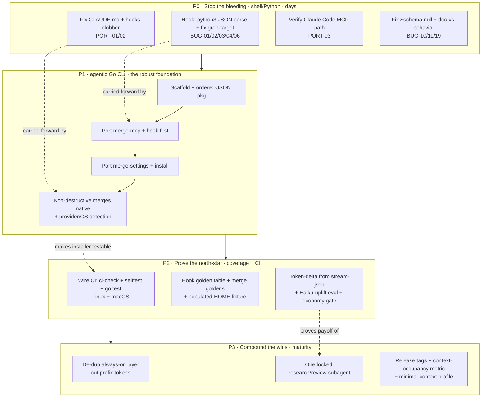

# Master plan — agentic-cfg review & rewrite

This is the connective plan for five sibling documents. Each was produced by an
independent reviewer; this file reconciles their overlaps, dedupes severity, and
sequences the work into a roadmap tied to the repo's north-star goals.

> Status: **P0 shipped, P1 next.** The non-destructive install + hook fixes are
> implemented, verified, and pushed on branch `fix/p0-stop-the-bleeding` — see
> [§8](#8-status--next) and [P0-WORKLOG.md](P0-WORKLOG.md). Decisions are resolved
> in [§7](#7-decisions-resolved); a re-baseline against `master` is in §7.1.

## 0. The five documents

| Doc | Owns | Headline |
|-----|------|----------|
| [01-go-rewrite.md](01-go-rewrite.md) | The `agentic` Go CLI migration | Phased port of install + merge-mcp + merge-settings + shell-guard into one cross-platform binary; evals stay Python. |
| [02-maturity-review.md](02-maturity-review.md) | Principal-engineer maturity vs AI/agentic SOTA | Strong architecture & docs; the gap is **measurement** — nothing proves the token/weak-agent wins on real sessions. |
| [03-gaps-and-bugs.md](03-gaps-and-bugs.md) | Concrete defect catalog | 23 findings (2 Critical, 6 High). The whole top cluster is one root cause: the shell hook parses JSON with grep/sed. |
| [04-portability-review.md](04-portability-review.md) | Cross-provider + co-existence with existing configs | Install **clobbers** a pre-existing `CLAUDE.md` and user `settings.json` hooks — directly violates the "don't lose existing configs" goal. |
| [05-test-coverage.md](05-test-coverage.md) | Test/harness coverage; "works together" | Good per-tool-in-isolation; **no integration test, no Haiku-uplift eval, no CI**. |

## 1. North-star goals (the yardstick)

Every recommendation below is judged against the owner's actual objectives, not
generic SWE polish:

1. **Cut tokens & context pollution** during agentic work.
2. **Uplift weak agents** — Haiku should perform dramatically better with the toolset.
3. **Make the toolset work together** — rtk + lean-ctx + ast-grep + gitnexus + skills + hooks + evals compose.
4. **Be generic** — Cursor, Claude, Claude Code; install cleanly on a fresh machine *and* on one that already has the user's configs **without clobbering them**.
5. **Subagents only if the token cost is justified.**

The review's blunt verdict: the repo is **mature in design and documentation, but
its two load-bearing mechanisms are fragile (the hook) and unsafe (the installer),
and none of the north-star claims are measured.** The roadmap fixes those three
things in that order: stop the harm, make the foundation robust, then prove the value.

## 2. Consolidated severity rollup (deduped across docs)

The same issues surfaced under multiple reviewers. Deduped and ranked:

### Critical — data loss or silent corruption
| ID | Issue | Source | Fixed by |
|----|-------|--------|----------|
| PORT-01 | `install_claude_md` **overwrites** an existing user `~/.claude/CLAUDE.md` (a `.bak` is kept, but the live global-memory file is replaced). | 04 | P0 + P1 |
| PORT-02 | `merge-settings.py:34` does `result["hooks"] = fragment["hooks"]` — **drops all pre-existing user hooks** of every event. (env/deny/allow *are* preserved.) | 04 | P0 + P1 |
| BUG-01 | shell-guard `extract()` only unescapes `\"`/`\\`, so **multiline commands are corrupted** (`echo a\necho b` → literal `\n`, second statement lost). | 03 | P0 bridge / P1 |
| BUG-02 | The `*'<<'*` glob matches **any `<<`** (heredoc *and* bit-shift `1 << 3`); the command is neither guarded nor compressed. | 03 | P0 / P1 |

### High — degrades every session, or breaks a provider/OS
| ID | Issue | Source | Fixed by |
|----|-------|--------|----------|
| BUG-03 | ast-grep deny **false-positives** on any code-extension substring anywhere in the line (incl. the grep *pattern text* and `build.cpp.log`). Blocked the reviewers' own greps repeatedly. | 03, 02, 05 | P0 |
| BUG-04 | ast-grep deny **false-negative**: `x=$(grep foo a.py)` slips through (detector anchors `grep` to a leading token). | 03 | P0 / P1 |
| BUG-06 | Double-wrap guard misses `FOO=1 rtk …` → `rtk FOO=1 rtk …`, contradicting the hook's own "no double-wrapping" promise. | 03 | P0 / P1 |
| PORT-03 | Claude writes `~/.claude/.mcp.json`, but Claude Code's user-scope MCP is conventionally `~/.claude.json` — **servers may never load for the CLI**. Must verify live. | 04 | P0 (verify) |
| PORT-04 | Docs claim Claude **Desktop + API** support, but only the Code/CLI surface is written. Overstated. | 04 | P0 (doc) / P1 |
| PORT-05 | First install **mass-moves** a user's real `~/.{cursor,claude}/skills` dir to a backup and replaces it with a symlink — their own skills leave the live path. | 04 | P1 |
| OBS / TEST | **No integration test** that runs the tools together; **no Haiku-uplift / token-delta eval**; **no CI** (`.github/workflows/` is empty). The north-star is unmeasured and unprotected. | 02, 05 | P2 |

### Medium / strategic (representative — full lists in each doc)
`$schema: null` written on a fresh settings file (BUG-10); ARCHITECTURE's "all
destructive writes back up" is false for standalone merge runs (BUG-11); `--dry-run`
never previews merge output (BUG-19); `bootstrap.sh` ignores `--dry-run` (BUG-18);
eval loaders crash with a bare traceback on one malformed case (BUG-22); triple-stated
"verify-before-done" and coding-principles/Karpathy overlap inflate the per-turn
prefix (MAT-05); value track captures token metrics but **doesn't gate on them**
(MAT-02); **zero git tags** for 13 CHANGELOG releases (MAT-06); no byte-stability
test for the rendered `CLAUDE.md` that the prompt cache depends on (MAT-07).

## 3. The single most important reconciliation: Go vs shell-now

Doc 01 and doc 03 raised a sequencing tension. Here is the ruling the roadmap uses.

- The **hot-path hook bugs (BUG-01/02/03/04/06)** and the **clobber bugs
  (PORT-01/02)** cause harm *today* and the Go binary is weeks out. They get an
  **interim fix in shell/Python now** (P0). Specifically: route the hook's JSON
  parsing through `python3 -c` (python3 is already a hard dependency) instead of
  grep/sed — this alone kills the entire `extract()` correctness class — and fix
  the grep-target detection and the merge clobbers.
- **Honest consequence:** once P0 routes JSON through python3 and fixes the merge
  semantics, the *correctness* case for Go is largely captured cheaply. The
  remaining, still-valid case for the Go CLI is **portability (no python3/bash/
  coreutils dependence at all), a single distributable binary, atomic writes, and
  — the big one — making the install path CI-testable cross-platform.** That is
  what doc 05 calls "the thing that finally makes the installer testable."
- Therefore Go (P1) is planned as the **durable home** that carries the P0
  semantics forward, not as the thing we wait for to stop the bleeding. This also
  lets us **right-size** Go: per doc 01, port merge-mcp + the hook first (fragility
  + hot path + portability core); install/bootstrap can stay shell longer if
  desired. See [§7](#7-decisions-needed-before-implementation) decision D1.

Doc 01's golden-file strategy depends on this: P0 patches are documented as the
*intentional* one-line diffs the Go goldens then assert, so the A/B byte-diff stays
clean. Doc 03's three verified "fixed-for-free" bugs (`$schema: null`, heredoc
bypass, non-atomic writes) cross-reference doc 01 for exactly this reason.

## 4. Phased roadmap

### P0 — Stop the bleeding (no waiting for Go)
Owns: data loss + actively-harmful behavior. All in shell/Python.
- **PORT-01/02:** back up + **managed-block merge** for `CLAUDE.md`; **event-wise
  deep-merge** of settings hooks so user hooks survive.
- **Hook hardening:** replace grep/sed `extract()` with `python3 -c` JSON parsing
  (kills BUG-01/05/07); fix grep-target detection to deny only when grep actually
  targets a code **file** (BUG-03/04); tighten the `<<` test (BUG-02); fix
  double-wrap (BUG-06).
- **PORT-03:** verify live where Claude Code reads user MCP; fix the path if wrong.
- **Cleanup:** stop emitting `$schema: null` (BUG-10); correct the ARCHITECTURE
  backup claim and make `--dry-run` preview merges (BUG-11/19).
- **Exit criteria:** crafted-input tests prove no data-loss path and no spurious
  denies; a pre-existing `CLAUDE.md`/hooks/skills survive a simulated install.

### P1 — The `agentic` Go CLI (robust, portable, testable foundation)
Owns: durable structural fix. Per doc 01, smallest-version-first.
- Scaffold module → `internal/jsonorder` ordered-map (the #1 byte-compat task) →
  port **merge-mcp + shell-guard hook** (fragility + hot path) → merge-settings →
  install → flip bootstrap to build `bin/agentic`. Keep shell/Python as fallback
  through every phase; each subcommand preserves the Python's positional contract
  for trivial A/B diff and rollback.
- Carry forward P0's non-destructive `CLAUDE.md`/hooks merges natively; add
  provider/OS detection (real Claude Code MCP path, optional Desktop target,
  per-skill symlinks with copy-mode fallback for Windows), one collision-free
  backup dir, fail-open hook.
- **Exit criteria:** golden/table tests green; A/B byte-diff vs Python documented
  (only the intended P0 diffs remain); bootstrap builds the binary; hook latency
  and fail-open verified.

### P2 — Prove the north-star (coverage + measurement + CI)
Owns: turning claims into measured, regression-protected facts. Per docs 05 + 02.
- **CI (force multiplier):** add `.github/workflows` running `ci-check.sh` +
  `selftest.py` + `go test` on **Linux and macOS**.
- **Determinism layer (cheap):** hook golden-envelope table test (enforcement can't
  silently regress); merge golden tests; **populated-`$HOME` install fixture**
  (existing `CLAUDE.md`, hooks, hand-added MCP, real skills dir all survive;
  idempotency — twice ⇒ identical, backups don't grow unbounded); byte-stability
  golden for the rendered `CLAUDE.md` (protects the prompt cache).
- **Measurement layer:** parse token usage from the stream-json `result` event so
  savings are **measured, not proxied**; gate the value track on token delta
  (MAT-02, ~20-line change — metrics already captured); commit a **Haiku-uplift**
  eval (same suite, weak model, toolset on vs off) and a full-toolset-vs-bare E2E.
- **Exit criteria:** CI green on every PR; a hook regression or a clobber is caught
  by a test; Haiku-uplift and token-delta have committed numbers.

### P3 — Compound the wins (maturity & leverage)
Owns: strategic gains that depend on P2 measurement existing. Per doc 02.
- **De-duplicate the always-on layer** (triple "verify-before-done";
  coding-principles vs Karpathy overlap) → fewer prefix tokens every turn, and a
  more stable cache prefix.
- **Ship ONE locked, cost-bounded subagent skill** (research/review): fixed worker
  model, read-only tools, explicit token/file ceiling, summary-only return,
  sequential by default. It serves both north-star halves (context isolation +
  tiering) — but only ship it **after** P2 so its payoff is measured, not asserted.
  Argue *against* open-ended parallel fan-out (real runaway-cost reports).
- **Release hygiene:** tag the 13 CHANGELOG releases; push the CI workflow.
- **New north-star instruments:** context-window occupancy as a first-class metric;
  a "minimal context" rendered profile for cheap/short tasks; skill-trigger
  precision as an ongoing data-driven loop; model-tiering guidance + a weak-agent
  regression gate so Opus-only evals stop masking Haiku regressions.

## 5. How each phase serves the north-star

| Phase | Tokens/context | Weak-agent uplift | Works together | Generic / no-clobber |
|-------|----------------|-------------------|----------------|----------------------|
| P0 | hook stops escaping compression | hook stops false-denying its work | — | **stops clobbering existing configs** |
| P1 | atomic, correct rendering | robust hook every call | one binary ties the glue together | single static binary, OS/provider detection |
| P2 | **measures** token delta | **measures** Haiku uplift | **integration test proves it** | populated-`$HOME` + Linux CI |
| P3 | smaller prefix, minimal-context mode | tiering + subagent isolation | subagent composes the toolset | — |

## 6. Cross-doc dependency ledger (reconciled)

- **01 ↔ 03:** Go closes BUG-01/02/03/04/05/06/07/08/12/15 for free. The roadmap
  patches the harmful subset in P0 (shell) and lets Go be the durable fix; P0 diffs
  become the Go goldens' expected output.
- **01 ↔ 04:** the static binary is the portability lever; doc 04 supplies the
  requirements it must satisfy (native non-destructive merges, real provider paths,
  per-skill symlinks, Windows copy fallback).
- **01 ↔ 05:** doc 05 hands doc 01 six test requirements (merge goldens, hook table,
  dry-run snapshots, idempotency, cross-platform `go test`, `$HOME` fixture);
  fixtures authored provider-agnostic so bash-now and Go-later share them.
- **02 ↔ 05:** doc 02's MAT-02/03 are *instrument* changes (economy gate, Haiku
  column); doc 05 owns the *case* backlog. Reconciled here so they don't double-count.
- **02/03 ↔ 04:** BUG-08 (BSD vs GNU `sed`, bash 3.2 — confirmed on this machine)
  is the portability flavor doc 04 owns; the stale lean-ctx-Claude wiring docs are
  a doc-04 mechanics item.

## 7. Decisions resolved

All decisions are settled (owner-approved 2026-06-26); each was chosen by analysis
of the repo and the north-star goals.

- **D1 — Go scope:** full `agentic` CLI, phased — port the hook + merge-mcp/-settings
  first, then install; `bootstrap.sh` stays shell (it installs Go itself). The
  consolidation's real prize is a cross-platform, CI-testable install path.
- **D2 — Go distribution:** build `bin/agentic` from the checkout in bootstrap
  (gitignored). `go install` breaks `AGENTIC_ROOT` discovery; committed binaries
  bloat and go stale.
- **D3 — Claude Code MCP path:** **confirmed** — Claude Code reads user-scope MCP
  from `~/.claude.json`, not `~/.claude/.mcp.json`. Register via `claude mcp add-json
  --scope user`; keep the Cursor file-merge. **Shipped in P0** (PORT-03).
- **D4 — Claude Desktop:** drop the "Desktop + API" support claim (API reads none of
  these files; Desktop uses a separate config). Add a Desktop target only if used.
  (Doc correction folded into the P1 docs pass.)
- **D5 — non-destructive CLAUDE.md/hooks:** use Claude Code's `@import` (confirmed
  supported) — render to a managed `~/.claude/agentic-cfg.generated.md` and keep a
  managed block in `CLAUDE.md`; deep-merge settings hooks by event. **Shipped in P0**
  (PORT-01/02).
- **D6 — subagent skill:** yes, one locked research/review subagent, but only in P3
  after P2 measurement proves the payoff.

### 7.1 Re-baseline vs `master` (important)

The five review docs were written against the stale `feature/value-evals-loop`
branch. `master` is **11 commits ahead** and changes several findings:

- **BUG-01 (multiline corruption) is already fixed** on `master` (`6f8b9f1` added a
  multiline / command-substitution / `cd` fail-open); BUG-04 became a deliberate
  fail-open. The remaining hook bugs (BUG-03 over-deny, BUG-06 double-wrap, the
  `$VAR` wrong-target hazard) were real on `master` and are **fixed in P0**.
- **Measurement already exists.** `master` ships `telemetry/` (token + cache-hit
  rate over real transcripts) and a cache-hit-rate regression gate
  (`evals/metric/`). Doc 02's "Observability: Nascent" and doc 05's "nothing
  measures tokens / no gate" are **overstated** — that foundation is there. What
  remains: a toolset-on/off A/B and a Haiku-uplift eval (P2), built on `telemetry/`.
- New unreviewed subsystems raise maturity: `core/memory/`, `issues/`.
- PORT-01/02/03 and BUG-10 were all still real on `master`, and are fixed in P0.

## 8. Status & next

**P0 (stop the bleeding) — shipped** on `fix/p0-stop-the-bleeding`, each step
verified and pushed (details in [P0-WORKLOG.md](P0-WORKLOG.md)):

- PORT-01 `CLAUDE.md` `@import` + legacy migration; PORT-02 hooks deep-merge;
  BUG-10 `$schema` null — commit `1dc45df`.
- PORT-03 Claude user-scope MCP registration (fixes gitnexus loading) — commit `e3af102`.
- BUG-03 grep over-deny + BUG-06 double-wrap + the `$VAR` wrong-target hazard —
  commit `9183378`.

**Next:** P1 — scaffold the `agentic` Go CLI per [01-go-rewrite.md](01-go-rewrite.md),
front-loading merge-mcp + the hook and carrying the P0 semantics forward as golden
tests. Then P2 (CI + integration + Haiku/token evals on top of `telemetry/`), then
P3 (instruction de-dup, the locked subagent, release hygiene).
