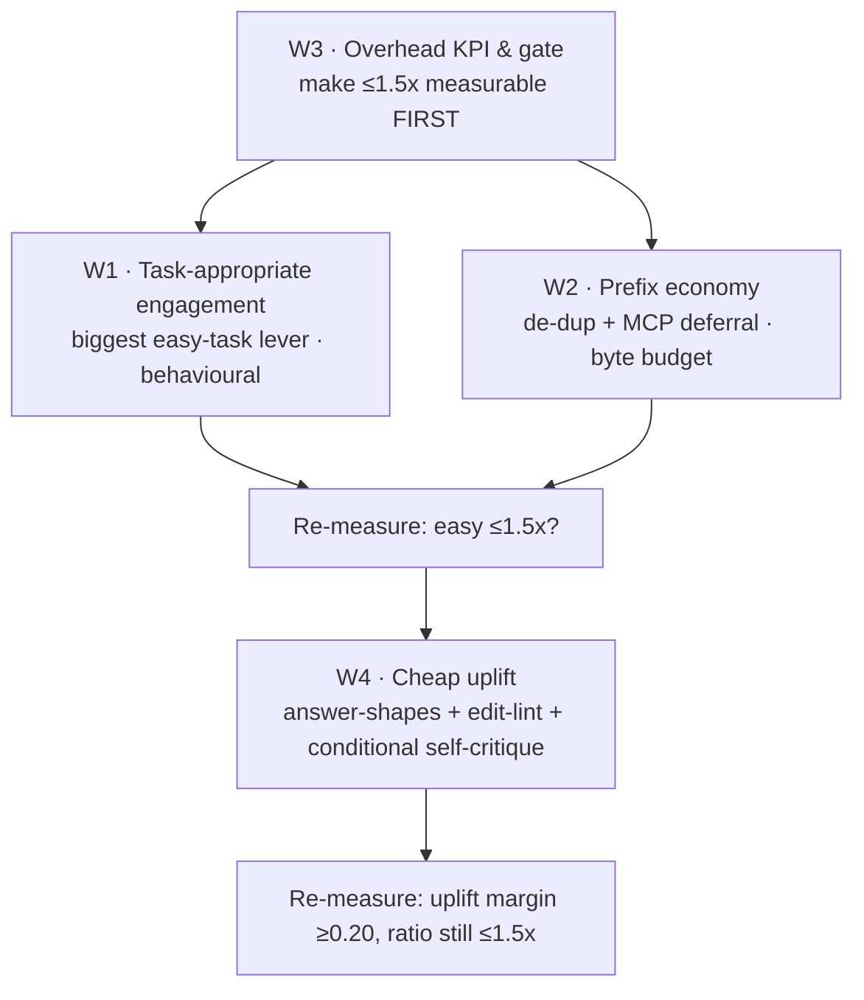

# 06 — Overhead & uplift: hit ≤1.5× token cost while making weak models smarter

This is the connective plan for the **overhead-and-uplift initiative**. It exists
because the bounded Haiku sample in [P2-measurement.md](P2-measurement.md) showed the
toolset costing ~2.9× the input tokens of a bare agent on an easy task, and the owner
set a hard bar: **the toolset may cost at most ~1.5× (ideally less) while still making
a weak model meaningfully smarter.**

It reconciles two bodies of work:

- the shipped P0–P2 program ([00-master-plan.md](00-master-plan.md)); and
- the **measure-and-uplift ADR program** authored on branch
  `docs/adr-measure-uplift-program` (`722d6e2`): seven ADRs + seven impl plans under
  `plans/adr/` and `plans/impl/` (not yet on `master`). Those are referenced throughout;
  this initiative *adopts them with overhead-targeting modifications* rather than
  duplicating them.

Detail plans live in [`impl-overhead/`](impl-overhead/):

| # | Workstream | Owns | File |
|---|-----------|------|------|
| W1 | Task-appropriate engagement | Stop over-tooling easy tasks (the #1 lever) | [01-task-appropriate-engagement.md](impl-overhead/01-task-appropriate-engagement.md) |
| W2 | Prefix economy | De-dup the always-on layer; defer/trim MCP schemas; weak-tier byte budget | [02-prefix-economy.md](impl-overhead/02-prefix-economy.md) |
| W3 | Overhead KPI & gate | The missing instrument: measure & gate the ON-vs-OFF ratio | [03-overhead-kpi-and-gate.md](impl-overhead/03-overhead-kpi-and-gate.md) |
| W4 | Cheap uplift | Token-cheap weak-model uplift; reprioritize ADR-0006 by token cost | [04-cheap-uplift.md](impl-overhead/04-cheap-uplift.md) |

---

## 1. Evidence — a decomposed re-measurement (2026-06-26)

The original P2 sample reported a single number (`total_input_tokens`, ~2.9×). That
number conflated three different things. This re-run decomposes them. Method: Haiku
(`claude-haiku-4-5-20251001`), two tasks, two arms each, **prompt-isolation** (OFF is
told to ignore the custom config/tools; both arms load the identical config — so this
isolates *induced behaviour*, not static prefix). Script:
[`evals/experiments/haiku_overhead_decomp.py`](../evals/experiments/haiku_overhead_decomp.py);
raw: [`data/haiku-overhead-2026-06-26.json`](data/haiku-overhead-2026-06-26.json).
n=1 per cell — directional, not a verdict.

### Easy task — "find every Go function whose last return type is `error`" (both arms correct, 4)

| metric | toolset ON | toolset OFF | ON/OFF |
|--------|-----------:|------------:|-------:|
| total input tokens | 339,284 | 86,298 | **3.93×** |
| of which `cache_read` (priced ~0.1×, flat-rate-unbilled on Max) | 323,277 | 73,496 | 4.40× |
| **repriced input** (`input` + `cache_creation` only) | **16,007** | **12,802** | **1.25×** |
| output tokens (most expensive class) | 2,263 | 839 | 2.70× |
| API-equivalent cost | $0.0756 | $0.0371 | **2.04×** |
| assistant turns / tool calls | 12 / 10 | 4 / 3 | ~3× |
| turn-1 prefix (always-on context) | 28,290 | 28,327 | **1.00×** |
| wall-clock | 65.6 s | 14.4 s | 4.6× |

### Hard task — "count call sites of the package-level `Send`, excluding the same-named method, strings, comments" (both arms correct, 3)

| metric | toolset ON | toolset OFF | ON/OFF |
|--------|-----------:|------------:|-------:|
| total input tokens | 148,847 | 205,557 | **0.72×** |
| API-equivalent cost | $0.0479 | $0.0575 | **0.83×** |
| output tokens | 1,157 | 2,001 | 0.58× |
| assistant turns / tool calls | 6 / 4 | 11 / 10 | ~0.5× |

## 2. What the data actually says (and corrects)

1. **The overhead is not the prefix.** Turn-1 always-on context is identical across arms
   (~28.3k) — under prompt-isolation both arms load the same config. The 3.93× on the
   easy task is `turns × per-turn re-read`, i.e. **induced behaviour**, not bytes in the
   prompt. (Static prefix only differs against a *truly bare* agent; that is a separate,
   directly-controllable axis — W2.)

2. **The defect is regime-specific over-engagement.** On the easy task the toolset drove
   Haiku to 12 turns / 10 tool calls to answer what a bare agent answered in 4 / 3 — pure
   overhead (3.93× input, 2.04× cost), same answer. On the hard task the toolset was
   *more efficient and equally correct* (0.72× input, 0.83× cost, half the turns): the
   bare arm flailed with grep (10 calls) to reach what the toolset got structurally in 4.
   **The toolset is not "too expensive" — it fails to right-size to the task.**

3. **"Input tokens" is ~95% `cache_read`.** On flat-rate Claude Max that is unbilled
   per-token (ADR-0001: "caps/throttling, not per-token billing"); even on API it is
   priced ~0.1×. The honestly-repriced input overhead on the easy task is **1.25×**, not
   3.93×. The real cost overhead (~2.04×) is driven by **extra turns** (re-reads compound)
   and **extra output** (2.70×, the genuinely expensive class).

4. **Uplift is real but showed up as efficiency, not as OFF-fails.** Both arms were
   correct on both tasks; the hard task's value was fewer turns / lower cost / structural
   precision. A correctness-uplift demonstration needs harder tasks where the bare arm
   actually fails — see W3/W4 and ADR-0006's differential gate.

## 3. Target definition (what "≤1.5×" means here)

Make it measurable and enforceable (W3 builds the instrument):

- **Primary gate — easy/lookup regime:** on a representative trivial task,
  `total_input_tokens(ON) / total_input_tokens(OFF) ≤ 1.5` **and**
  `cost(ON) / cost(OFF) ≤ 1.5`, with **no correctness regression**.
- **Guard — hard regime:** `total_input(ON)/total_input(OFF) ≤ 1.0` is *maintained*
  (the toolset must keep paying for itself where it matters; today 0.72×).
- **Uplift floor (from ADR-0003/0006):** any scaffold ships only if weak-model win
  margin exceeds strong-model margin by ≥ 0.20 (`weak_uplift_exceeds_strong`).

## 4. Why the easy-task ratio is reachable — projected gains

The dominant lever is **turns**, not bytes. Re-reads scale ~linearly with turns, so
bringing the easy-task ON path from 12 turns to ~4 (W1) projects:

- `total_input` ON ≈ from 339k toward ~95–120k → **~1.1–1.4×** vs OFF's 86k (was 3.93×).
- output ON ≈ from 2,263 toward ~900 → cost ratio toward **~1.1–1.3×** (was 2.04×).

W2 (prefix trim + MCP-schema deferral on the weak tier) multiplies across every turn,
adding margin on both regimes; W2 is the only lever that also helps against a *truly
bare* agent. These are projections from the n=1 decomposition and **must be re-measured**
by W3 before being claimed.

## 5. Prioritized roadmap (by gain-per-token-of-effort)

1. **W3 first** — you cannot hit a target you cannot see. Build the ON-vs-OFF overhead
   KPI + gate (extends `telemetry/`, the ADR-0004 scorecard). Cheap, zero-LLM for the
   deterministic parts; the A/B itself is the only LLM cost and is already scripted.
2. **W1 next** — the single biggest easy-task lever and nearly free in tokens: a compact
   "right-size the tooling to the task" rule that *replaces* (not adds to) the current
   always-on tool-precedence prose, which today pushes the heavy stack for every action.
3. **W2 in parallel** — de-duplicate the always-on layer (MAT-05: "verify-before-done"
   stated 3×; coding-principles/Karpathy overlap) and defer/trim the lean-ctx MCP tool
   surface for the weak tier. Funds W1's rule byte-for-byte; helps the bare-agent axis.
4. **W4 last** — only after W1–W3 prove the ratio is under control, add the *token-cheap*
   uplift levers from ADR-0006, reprioritized: answer-shapes + edit-lint hook
   (token-neutral) and **conditional** self-critique before the exemplar-heavy plan-first
   scaffold (which is rendered weak-tier-only via the ADR-0006 model-tier fork).

## 6. Relationship to the ADR program (`722d6e2`)

This initiative does not replace the ADR program; it **front-loads the overhead axis it
is missing** and reprioritizes its uplift content by token cost. Mapping:

| This initiative | Adopts from ADR program | Modification |
|---|---|---|
| W3 overhead KPI/gate | ADR-0001/0004 (`report.py`, `scorecard.py`, `experiment.py`) | **New row + gate**: ON-vs-OFF overhead ratio. The ADRs measure Opus token-*share* and cache-hit, never the ON/OFF multiplier — this adds it. |
| W2 prefix economy | ADR-0006 model-tier render fork; P2-13 cache gate | **New constraint**: weak-tier render must meet a hard byte/overhead budget, not merely be "≥ strong". Add MCP-schema deferral/trim. |
| W1 engagement | ADR-0005 routing/effort/single-threaded | **New always-on rule**: task-weight→tool-weight triage, authored as a *replacement* for verbose precedence prose to stay byte-neutral. |
| W4 cheap uplift | ADR-0006 scaffolds (plan-first, self-critique, answer-shapes, edit-lint) | **Reordered by token cost**: ship answer-shapes + edit-lint + conditional self-critique first; gate exemplar-heavy plan-first behind weak-tier-only render + the ≤1.5× gate. |

Open decision for the owner (see each detail plan's "Decisions" section): whether to
**merge the ADR branch to `master` first** (then layer W1–W4 on top) or **cherry-pick**
the telemetry/render machinery W2/W3 depend on. Recommended: merge the ADR branch's
non-behavioural machinery (telemetry/eval backbone, the render fork plumbing) and hold
its behavioural scaffolds for W4, so the gate exists before any prefix-growing content.

## 7. Status

Planning only. No behavioural change has been made this turn. The decomposed
measurement, its script, and these plans are the deliverable. Implementation is gated on
owner approval of the roadmap and (for W3's A/B re-runs) the same bounded-LLM-spend nod
already given for the P2 sample.
